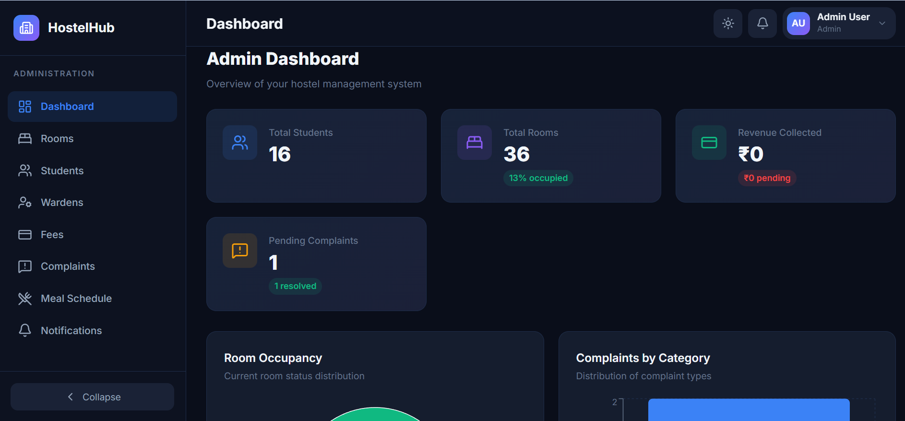
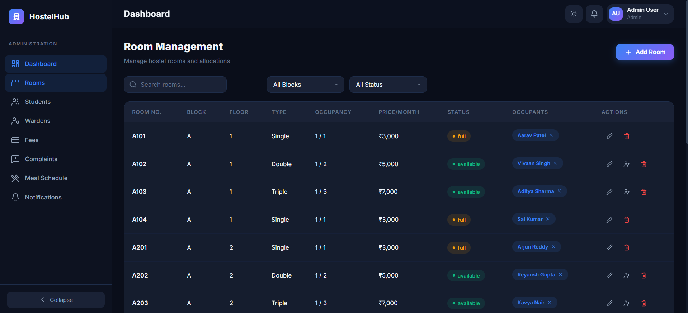
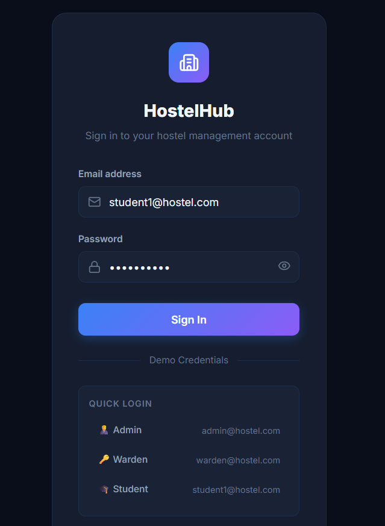

# 🏨 HostelHub — Modern Hostel Management System

<p align="center">
  
  
  
  
  
</p>

<p align="center">
  A full-stack, role-based hostel management platform designed to simplify hostel administration, room allocation, student management, fee tracking, and complaint handling.
</p>

---

## 👨‍💻 Project Information

| Detail | Information |
|:---|:---|
| **Project Name** | HostelHub |
| **Developed By** | Aryan Kumar |
| **University Roll Number** | 2501010043 |
| **Technology** | MERN Stack |
| **Project Type** | Full-Stack Web Application |

---

## 🚀 Live Demo

| Component | Link |
|:---|:---|
| **Frontend Application** | [View Live Application](https://hostel-hub-rashid.vercel.app/) |
| **Backend API** | [API Health Check](https://hostel-management-system-f4pb.onrender.com/api/health) |

## 🔑 Demo Credentials

Use the following credentials to explore the application:

| Role | Email | Password | Access |
|:---|:---|:---|:---|
| **Admin** | `admin@hostel.com` | `admin123` | Full administrative access |
| **Warden** | `warden@hostel.com` | `warden123` | Complaints, meals, attendance |
| **Student** | `student1@hostel.com` | `student123` | Profile, fees, complaints |

---

## 📸 Application Screenshots

The following screenshots showcase the main interfaces of HostelHub.

| Admin Dashboard | Room Management |
|:---:|:---:|
|  |  |
| *Analytics and administrative overview* | *Room availability and allocation* |

| Student Portal | Login Page |
|:---:|:---:|
|  |  |
| *Personalized student dashboard* | *User authentication interface* |

> **Note:** Add the corresponding images to the `screenshots/` directory to display them correctly.

---

## ✨ Key Features

### 👑 1. Admin Dashboard
- Interactive dashboard with visual analytics and charts.
- Monitor room occupancy and fee collection.
- Manage hostel rooms and room allocations.
- Perform CRUD operations on student records.
- Manage wardens and other hostel staff.
- Monitor complaints and hostel activities.

### 🛡️ 2. Warden Dashboard
- View and manage student complaints.
- Update and manage weekly meal schedules.
- Maintain student attendance.
- Publish important hostel announcements.
- Track and update complaint resolution status.

### 🎓 3. Student Portal
- View personal profile and room allocation details.
- Check hostel fee status and payment history.
- Submit complaints and monitor their progress.
- Access hostel notices and announcements.
- View weekly meal schedules.

---

## 🛠️ Technology Stack

| Category | Technologies |
|:---|:---|
| **Frontend** | React 19, Vite |
| **Styling** | Tailwind CSS, Custom Design System |
| **Animations** | Framer Motion |
| **Charts** | Recharts |
| **Routing** | React Router v7 |
| **Backend** | Node.js, Express.js v5 |
| **Database** | MongoDB Atlas, In-Memory MongoDB |
| **ODM** | Mongoose |
| **Authentication** | JWT, Secure Cookies |
| **API Integration** | Axios |
| **Deployment** | Vercel, Render |

---

## 📂 Project Structure

```text
hostel-management-system/
│
├── client/                     # React Frontend
│   ├── src/
│   │   ├── components/         # Reusable UI components
│   │   ├── contexts/           # Authentication and Theme Context
│   │   ├── pages/              # Application pages
│   │   ├── services/           # API integration
│   │   └── App.jsx             # Main routing configuration
│   │
│   └── vite.config.js
│
├── server/                     # Node.js Backend
│   ├── config/                 # Database configuration
│   ├── controllers/            # Request handlers
│   ├── middleware/             # Authentication and validation
│   ├── models/                 # Mongoose schemas
│   ├── routes/                 # API routes
│   └── server.js               # Server entry point
│
└── README.md
```

---

## ⚙️ Installation & Setup

Follow these steps to run HostelHub locally.

### 1. Clone the Repository

```bash
git clone https://github.com/rashkhan94/hostel-management-system.git

cd hostel-management-system
```

### 2. Install Dependencies

**Backend:**

```bash
cd server
npm install
```

**Frontend:**

```bash
cd ../client
npm install
```

### 3. Environment Configuration

Create a `.env` file inside the `server/` directory.

Configure the required environment variables according to your project setup. Refer to `server/.env.example` if available.

The development environment supports an in-memory MongoDB database for local testing.

### 4. Run the Application

Open two separate terminals.

**Terminal 1 — Backend**

```bash
cd server
npm run dev
```

**Terminal 2 — Frontend**

```bash
cd client
npm run dev
```

Open the local development URL displayed by Vite in your browser.

---

## 📡 API Endpoints

| HTTP Method | Endpoint | Description |
|:---|:---|:---|
| POST | `/api/auth/login` | Authenticate users |
| GET | `/api/dashboard/stats` | Retrieve dashboard analytics |
| GET | `/api/rooms` | Fetch hostel room details |
| POST | `/api/complaints` | Submit a student complaint |
| GET | `/api/meals` | Retrieve weekly meal schedules |

---

## 🔐 Authentication & Authorization

HostelHub implements role-based authentication using JSON Web Tokens (JWT).

The application supports three user roles:

- **Admin:** Complete access to administrative features.
- **Warden:** Access to hostel operations and student-related activities.
- **Student:** Access to personal information and student services.

Secure cookie-based token storage is used for authentication.

---

## 🎯 Project Objective

The primary objective of HostelHub is to develop a centralized digital platform that improves hostel administration and communication between administrators, wardens, and students.

By integrating room management, fee tracking, complaint handling, attendance, and announcements into a single application, HostelHub aims to make hostel operations more organized, efficient, and accessible.

---

## 👨‍🎓 Developer

**Aryan Kumar**

- **University Roll Number:** 2501010043
- **Project:** HostelHub — Modern Hostel Management System
- **Technology:** MERN Stack

---

<p align="center">
  <b>HostelHub — Simplifying Hostel Management Through Technology.</b>
</p>
